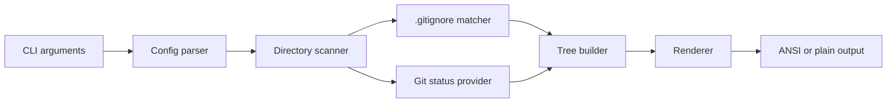

<div align="center">

# xtree

**A focused, fast, and maintainable C++17 command-line utility that prints directory contents as a compact, human-readable tree.**

[](https://en.cppreference.com/w/cpp/17)
[](https://cmake.org)
[](#requirements)
[](./LICENSE)
[](#contributing)

[Quick Start](#quick-start) · [Options](#options) · [Examples](#examples) · [Benchmarks](#benchmarks) · [Contributing](#contributing)

</div>

---

> [!NOTE]
> `xtree` is built for developers and CI systems that need a concise view of a project tree — with optional metadata such as file sizes, Git status, and simple project statistics. The codebase is modular, follows modern C++ idioms, and is set up for reproducible builds and automated testing.

## Table of Contents

- [About](#about)
- [Features](#features)
- [Requirements](#requirements)
- [Quick Start](#quick-start)
- [Build](#build)
- [Usage](#usage)
- [Options](#options)
- [Examples](#examples)
- [Architecture](#architecture)
- [Development](#development)
- [Benchmarks](#benchmarks)
- [Packaging](#packaging)
- [License](#license)
- [Contributing](#contributing)

---

## About

`xtree` walks a directory and renders it as an ASCII tree with clear branches, colorized output, and rich metadata — file sizes, directory disk usage, Git status, branches, and last-commit author/date. It respects `.gitignore` rules (including nested files, `**`, and negation patterns), supports custom exclusions, and runs on any platform that ships a C++17 filesystem implementation.

## Features

| Capability | What it does |
|---|---|
| **Tree rendering** | Recursive directory tree with clear ASCII branches |
| **Color output** | Configurable ANSI coloring for directories, files, and status flags |
| **Sizes** | Optional per-file sizes and directory disk-usage (DU) |
| **Git integration** | File status (`M`/`A`/`D`/`R`/`C`/`U`), branches, last-commit author and date |
| **Project stats** | `--stats` reports total files and total lines |
| **.gitignore** | Honors `.gitignore` rules with `--gitignore`, including nested files, `**`, and negation |
| **Custom excludes** | Fine-grained exclusions via `--ignore` |
| **Portable** | Cross-platform via `std::filesystem`, small dependency surface |

## Requirements

| Dependency | Version |
|---|---|
| Compiler | GCC 8+, Clang 7+, or MSVC 2017+ (C++17) |
| CMake | `>= 3.10` — recommended for the full build, tests, and packaging |

## Quick Start

```bash
git clone https://github.com/C0dwiz/xtree.git
cd xtree
cmake -S . -B build -DCMAKE_BUILD_TYPE=Release
cmake --build build -j$(nproc)
```

A minimal `Makefile` is also provided for quick builds:

```bash
make -j$(nproc)
```

> [!TIP]
> Run `./build/xtree --help` at any point to see the full option set, defaults, and examples.

---

## Build

<details>
<summary><strong>Run the test suite</strong></summary>

```bash
ctest --test-dir build --output-on-failure
```

</details>

<details>
<summary><strong>Install system-wide</strong></summary>

```bash
sudo cmake --install build --prefix /usr/local
```

</details>

<details>
<summary><strong>Install to a local prefix</strong></summary>

```bash
cmake --install build --prefix "$HOME/.local"
```

</details>

## Usage

```text
xtree [OPTIONS] [PATH]
```

If `PATH` is omitted, `.` (the current directory) is used.

## Options

The most commonly used options are listed below. Run `xtree --help` for the complete set.

| Option | Description |
|---|---|
| `--help` | Show help message |
| `--all` | Show hidden files (dotfiles) |
| `--size` | Display file sizes next to files |
| `--du` | Show directory sizes (summed file sizes) |
| `--no-color` | Disable ANSI color codes in output |
| `--depth N` | Limit recursion to N levels |
| `--ignore="ext, name"` | Ignore files by extension or exact name (comma-separated) |
| `--gitignore` | Ignore files and folders matched by `.gitignore` |
| `--git` | Enable Git-aware output (status, branches, author/date) |
| `--follow-links` | Follow symbolic links when descending directories |
| `--stats` | Print total number of files and total lines at the end |

## Examples

<details open>
<summary><strong>Current tree with sizes and hidden files</strong></summary>

```bash
./build/xtree --all --size
```

</details>

<details>
<summary><strong>Git statuses, skip <code>build/</code> and <code>.git/</code>, print project stats</strong></summary>

```bash
./build/xtree --git --ignore="build,.git" --stats
```

</details>

<details>
<summary><strong>Two directory levels, no color</strong></summary>

```bash
./build/xtree --depth 2 --no-color
```

</details>

<details>
<summary><strong>Rules from <code>.gitignore</code>, including nested rules and negated patterns</strong></summary>

```bash
./build/xtree --gitignore --all --stats
```

</details>

---

## Architecture

A conceptual pipeline from CLI arguments to rendered output:



---

## Development

<details>
<summary><strong>Format source files</strong></summary>

A `.clang-format` file is present. Format tracked source files with:

```bash
git ls-files '*.cpp' '*.cc' '*.c' '*.hpp' '*.hh' '*.h' \
  | xargs clang-format -style=file -i
```

</details>

<details>
<summary><strong>Tests</strong></summary>

Tests are integrated via CTest:

```bash
ctest --test-dir build --output-on-failure
```

A portable CLI test is also available through `make test`.

</details>

## Benchmarks

`benchs/bench.sh` compares `xtree` with the standard `tree` command on the same reproducible directory tree. It reports average wall time and peak RSS; `tree` is skipped cleanly when it is not installed.

```bash
make bench
BENCH_DEPTH=6 BENCH_BRANCHES=4 BENCH_FILES=20 BENCH_REPEATS=5 make bench
```

Override the defaults with `XTREE_BIN`, `TREE_BIN`, `BENCH_DIR=...`, or `KEEP_BENCH_DIR=1`.

> [!WARNING]
> Benchmark numbers are machine-specific and should not be treated as CI thresholds.[^1]

[^1]: The project provides a minimal `Makefile` and a full CMake build that enables testing and packaging via CPack.

## Packaging

After configuring the build directory, use CPack inside `build/` to generate archives or native packages (TGZ/DEB):

```bash
cd build
cpack
```

The resulting artifacts will be placed in the `build/` directory.

## License

Distributed under the **Mozilla Public License v2.0**. See the [`LICENSE`](./LICENSE) file for details.

## Contributing

Contributions are welcome. Before opening a pull request:

- [ ] Fork the repository and create a clear, focused branch for your change.
- [ ] Run code formatting and tests locally.
- [ ] Write a brief description of the change and the rationale in the PR.

Maintainers review PRs and request changes where necessary.

---

<div align="center">
<sub>Built with modern C++ — small, sharp, and focused on the tree.</sub>
</div>